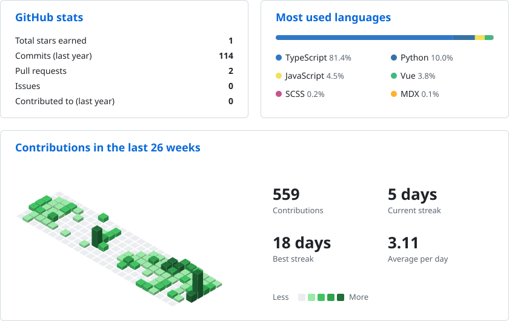

<picture>
  <source media="(prefers-color-scheme: dark)" srcset="./assets/banner-dark.svg" />
  <source media="(prefers-color-scheme: light)" srcset="./assets/banner-light.svg" />
  
</picture>

  <a href="https://criptonlabs.com"><strong>Criptonlabs</strong></a> ·
  <a href="https://nelomr.github.io/components-kit/"><strong>Live Storybook Hub</strong></a> ·
  <a href="https://github.com/criptonlabs"><strong>@criptonlabs Org</strong></a>

Senior Frontend Engineer with ~10 years of experience architecting production SaaS interfaces, dual-framework design systems, high-throughput visualization engines, and local-first software.

> [!NOTE]
> **Currently building:** 60 FPS headless telemetry rendering ([`trace-kit`](https://github.com/nelomr/trace-kit)), local-first crypto wealth & FIFO tax accounting ([`criptofolio`](https://github.com/nelomr/criptofolio)), and AI agent infrastructure with MCP & x402 on-chain payments ([`criptonlabs`](https://github.com/criptonlabs)).

---

### Selected Systems & Open Source

| Project | Problem & Architecture | Core Stack | Links |
| :--- | :--- | :--- | :--- |
| **[`trace-kit`](https://github.com/nelomr/trace-kit)** | Headless high-throughput visualization engine for time-series and physical signals, targeting 60 FPS pan/zoom over 10⁵–10⁶ points. Canvas2D and WebGL2 renderers, zero-copy Web Worker transport, LTTB & Min-Max decimation; Vue and React bindings planned. | TypeScript · WebGL2 · Canvas2D · Web Workers · Turborepo | `MIT` · Pre-alpha |
| **[`criptofolio`](https://github.com/nelomr/criptofolio)** | Privacy-first, local-first crypto portfolio & Spanish AEAT-compliant FIFO tax engine. Hexagonal architecture, dual SQLite + DuckDB engine, AES-256-GCM local vault, read-only AI advisor (Ollama/cloud). | TypeScript · Vue 3 · SQLite · DuckDB · Hexagonal · Local-First | `AGPL-3.0` |
| **[`components-kit`](https://github.com/nelomr/components-kit)** | Dual-framework UI component library (14 Vue 3 + 14 React 19 components) built from single-source SCSS with WCAG 2.1 AA compliance and full tree-shaking. | Vue 3 · React 19 · Vite+ (Rolldown) · Storybook 10 · Nx | [`Live Hub`](https://nelomr.github.io/components-kit/) · `MIT` |
| **[`agent-apis-sdk`](https://github.com/criptonlabs/agent-apis-sdk)** | TypeScript SDK enabling AI agents to query XRP Ledger & Solana data through MCP, Vercel AI SDK, Mastra and ElizaOS tools, with opt-in x402 stablecoin payments (RLUSD, USDC, EURC). | TypeScript · MCP · XRPL · Solana · x402 · Vercel AI SDK | `Apache-2.0` · Pre-release |
| **[`claude-mods`](https://github.com/nelomr/claude-mods)** | Local-first plugin marketplace for Claude Code (`kolen-plugins`), featuring `kolen-sdd-progress` for real-time OpenSpec phase and blocker tracking with zero token overhead. | TypeScript · Claude Code · OpenSpec · SDD | `MIT` |

---

### Live Engineering Pulse

<!-- ACTIVITY:START -->
| Repository | Latest Update | Latest Commit / Release |
| :--- | :--- | :--- |
| [`criptonlabs/agent-apis-sdk`](https://github.com/criptonlabs/agent-apis-sdk) | `2026-11-16` | [`@criptonlabs/agent-apis-xrpl@0.0.1`](https://github.com/criptonlabs/agent-apis-sdk/releases/tag/%40criptonlabs/agent-apis-xrpl%400.0.1) · [chore: version packages (#1)](https://github.com/criptonlabs/agent-apis-sdk/commit/0d50c1fc1bba15e0313108d9e9e0db60613528dd) |
| [`nelomr/trace-kit`](https://github.com/nelomr/trace-kit) | `2026-11-06` | [`v0.0.11`](https://github.com/nelomr/trace-kit/releases/tag/v0.0.11) · [chore(release): version packages \[skip ci\]](https://github.com/nelomr/trace-kit/commit/7d204110f038341586d899926e8e2f462eb2e132) |
| [`nelomr/claude-mods`](https://github.com/nelomr/claude-mods) | `2026-10-25` | [chore: drop types field from plugin manifest](https://github.com/nelomr/claude-mods/commit/94b2a05025cd37019398a4883f4cc4d2df5aec25) |
| [`nelomr/components-kit`](https://github.com/nelomr/components-kit) | `2026-10-24` | [feat(monorepo): introduce multi-framework architecture with vue 3 a…](https://github.com/nelomr/components-kit/commit/9f9a53795356617a11067ff3827f998ec8f4ab50) |
| [`nelomr/criptofolio`](https://github.com/nelomr/criptofolio) | `2026-10-17` | [chore(release): set initial pre-stable version 0.1.0](https://github.com/nelomr/criptofolio/commit/2f652d8bbbee54af6bd57f664039fc0abed610fc) |

*Auto-synced daily via GitHub Actions · Last change: `2026-11-19` UTC.*
<!-- ACTIVITY:END -->

---

### Engineering Principles

* **Spec-Driven Development (SDD):** Contracts, OpenSpec artifacts, and deterministic quality gates before implementation—especially when orchestrating AI coding agents.
* **Clean & Hexagonal Boundaries:** Domain logic strictly decoupled from frameworks, storage engines, and transport layers.
* **Performance as a Feature:** Zero-copy typed buffers, off-main-thread Web Workers, and predictable rendering pipelines over premature abstractions.
* **Local-First & Sovereignty:** Sensitive operational and financial data belongs on the user's machine with verifiable encryption, not locked inside third-party clouds.

<strong>Technical Stack & Toolchain</strong> (click to expand)

 

| Area | Tools & Technologies |
| :--- | :--- |
| **Frontend & UI** | Vue 3 (Composition API, Pinia, Pinia Colada), React 19, TypeScript, Tailwind CSS, BEM / SCSS, Storybook 10 |
| **Graphics & Data Viz** | WebGL2, Canvas2D, Web Workers, TypedArrays, LTTB / Min-Max Decimation |
| **Data & Local-First** | SQLite, DuckDB, Parquet, AES-256-GCM, Hexagonal Architecture |
| **Monorepos & Quality** | pnpm workspaces, Turborepo, Lerna + Nx, Vite+ (Rolldown), Vitest, Visual Regression, Commitlint, Gitleaks |
| **AI & Web3 Infra** | Claude Code Plugins, OpenSpec (SDD), MCP, Vercel AI SDK, XRP Ledger, Solana, x402 Protocol |

---

### Activity & Language Footprint

<picture>
  <source media="(prefers-color-scheme: dark)" srcset="./assets/metrics-dark.svg" />
  <source media="(prefers-color-scheme: light)" srcset="./assets/metrics-light.svg" />
  
</picture>
